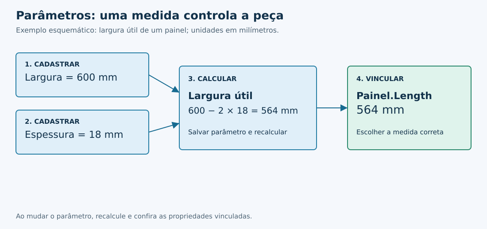
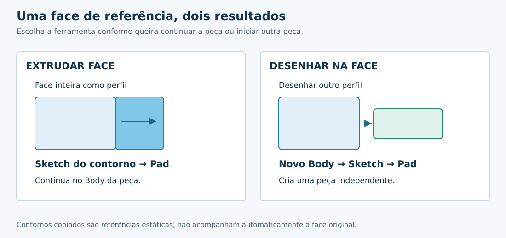
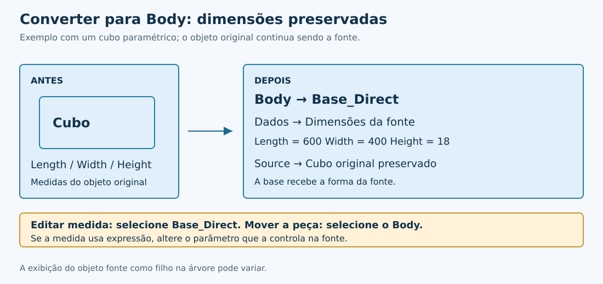
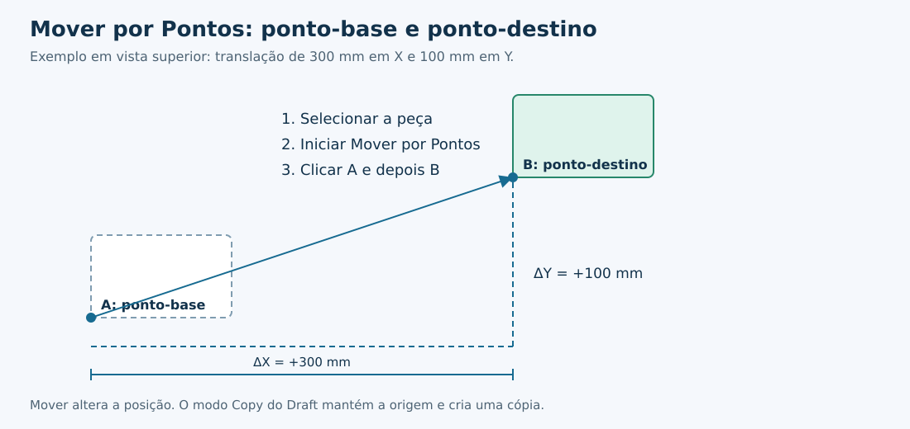
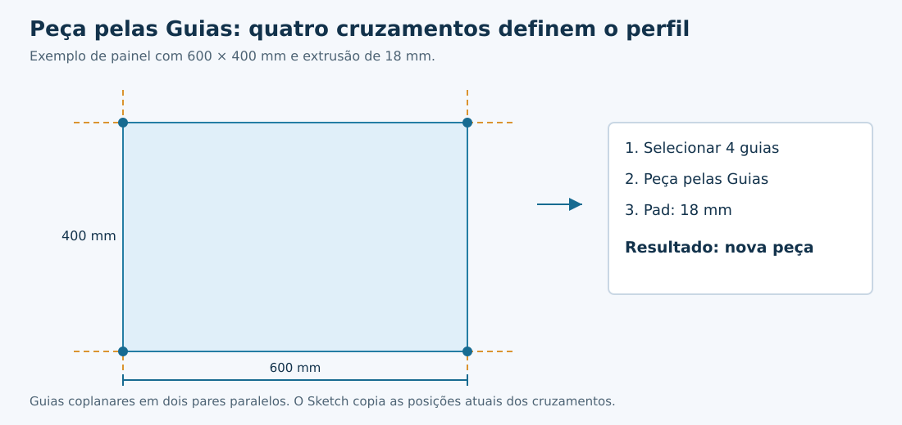
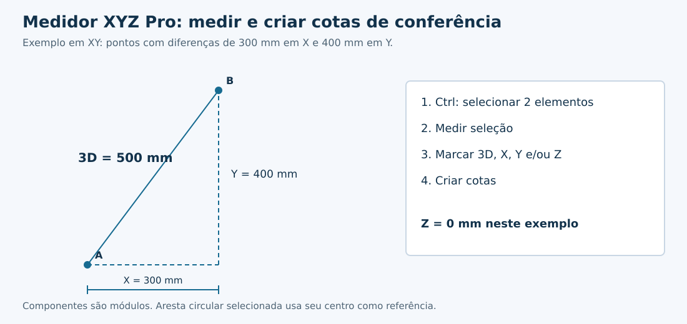
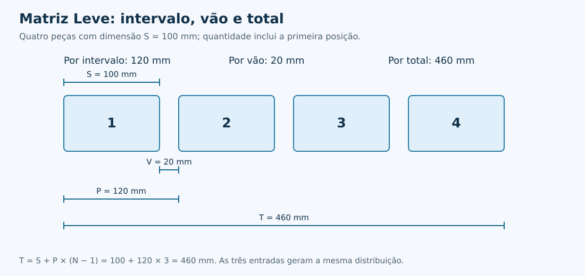
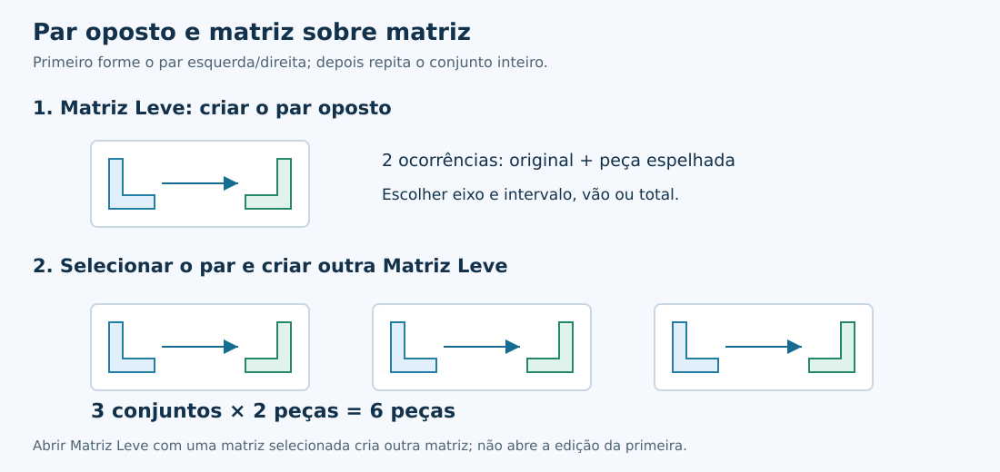

# Direct

Workbench para FreeCAD voltada a modelagem direta, criação e edição de peças, posicionamento, linhas guia, medição e matrizes.

**Versão declarada no pacote:** 0.9.12  
**Revisão de referência:** código do commit `1349efc`, de 20/10/2026  
**Ambiente de referência:** FreeCAD 1.1.3 no Linux

Este manual descreve o estado do código dessa revisão, incluindo as atualizações de Parâmetros, conversão paramétrica para Body e Matriz Leve posteriores à publicação original da versão 0.9.12. O número do pacote não foi alterado por esta revisão documental.

## Objetivo

A Direct reúne ferramentas para acelerar tarefas de modelagem e montagem mantendo compatibilidade com os recursos nativos do FreeCAD. Os comandos priorizam fluxos curtos, preservação da posição global e baixa dependência topológica entre peças.

## Conteúdo

- [Objetivo](#objetivo)
- [Instalação](#instalação)
  - [Windows](#instalação-no-windows)
  - [Linux por Git](#instalação-por-git-no-linux)
- [Leitura das figuras](#leitura-das-figuras)
- [Conceitos básicos](#conceitos-básicos)
- [Ferramentas](#ferramentas)
  - [Parâmetros](#parâmetros)
  - [Extrudar Face](#extrudar-face)
  - [Desenhar na Face](#desenhar-na-face)
  - [Converter para Body](#converter-para-body)
  - [Mover por Pontos](#mover-por-pontos)
  - [Manipulador](#manipulador)
  - [Posicionar Peça](#posicionar-peça)
  - [Linha Guia](#linha-guia)
  - [Snap Cruzamento de Guias](#snap-cruzamento-de-guias)
  - [Peça pelas Guias](#peça-pelas-guias)
  - [Medidor XYZ Pro](#medidor-xyz-pro)
  - [Matriz Leve](#matriz-leve)
  - [Matriz de Furação](#matriz-de-furação)
  - [Mover na Árvore](#mover-na-árvore)
- [Regras de seleção e posição](#regras-de-seleção-e-posição)
- [Fluxos de trabalho](#fluxos-de-trabalho)
- [Diagnóstico e limitações](#diagnóstico-e-limitações)
- [Atualizações documentadas](#atualizações-documentadas)
- [Compatibilidade](#compatibilidade)
- [Licença](#licença)

## Instalação

### Instalação manual

1. Feche o FreeCAD.
2. Obtenha os arquivos do repositório [FreeCAD-Direct](https://github.com/SergioUhry/FreeCAD-Direct).
3. Crie uma pasta chamada `Direct` no diretório de módulos do usuário e copie os arquivos da bancada para dentro dela.
4. Confirme que `Init.py` e `InitGui.py` estão diretamente em `Mod/Direct/`, sem uma pasta adicional entre eles.
5. Reinicie o FreeCAD e selecione **Direct** no seletor de bancadas.

No ambiente Linux de referência, o diretório é:

```text
~/.local/share/FreeCAD/v1-1/Mod/Direct/
```

Outras instalações podem usar `~/.local/share/FreeCAD/Mod/Direct/`. Para identificar o diretório da instalação em uso, abra o console Python do FreeCAD e execute:

```python
App.getUserAppDataDir()
```

Esse comando apenas informa o diretório de dados do usuário. A pasta da bancada deve ficar em `Mod/Direct/` dentro desse diretório.

| Arquivo ou pasta | Função |
|---|---|
| `Init.py` | Inicialização do módulo |
| `InitGui.py` | Registro da bancada e integração dos comandos |
| `package.xml` | Identificação, licença e versão declarada do pacote |
| `Resources/icons/` | Ícones das ferramentas |
| `uhrydirect/` | Módulos de implementação |
| `LICENSE` | Termos da licença |

A bancada utiliza os recursos instalados do FreeCAD, incluindo Draft, Part Design, Sketcher e a interface Qt distribuída com o programa. Não é necessário instalar bibliotecas Python externas para os fluxos descritos aqui.

### Instalação no Windows

O procedimento manual permite instalar a bancada pelo Explorador de Arquivos, sem terminal, Git ou instalação separada de Python.

**1. Identificar o diretório usado pelo FreeCAD**

1. Abra o FreeCAD.
2. No menu **Exibir → Painéis**, habilite **Console Python**. Em uma interface em inglês, use **View → Panels → Python console**.
3. Digite no console do próprio FreeCAD:

```python
App.getUserAppDataDir()
```

4. Pressione `Enter` e anote o caminho retornado. Não execute esse comando no Prompt de Comando nem no PowerShell: ele depende do ambiente interno do FreeCAD.
5. Feche o FreeCAD antes de copiar os módulos.

O diretório tradicional de módulos do usuário fica sob `%APPDATA%\FreeCAD\Mod`. Algumas instalações separam os dados por versão, por exemplo `%APPDATA%\FreeCAD\v1-1\Mod`. Use o caminho efetivamente retornado pela instalação em uso e acrescente `Mod\Direct`.

| Diretório de dados retornado, como exemplo | Pasta de instalação da Direct |
|---|---|
| `C:\Users\usuario\AppData\Roaming\FreeCAD\` | `C:\Users\usuario\AppData\Roaming\FreeCAD\Mod\Direct\` |
| `C:\Users\usuario\AppData\Roaming\FreeCAD\v1-1\` | `C:\Users\usuario\AppData\Roaming\FreeCAD\v1-1\Mod\Direct\` |

`usuario` representa o nome da conta do Windows. `%APPDATA%` é uma variável do Windows que aponta para a pasta de dados móveis do usuário. Para abrir sua localização no Explorador, pressione `Win + R`, digite `%APPDATA%` e confirme. Para o destino da bancada, dê preferência ao caminho confirmado pelo console.

**2. Baixar e extrair**

1. Acesse o [repositório FreeCAD-Direct](https://github.com/SergioUhry/FreeCAD-Direct).
2. Clique no botão **Code** e escolha **Download ZIP**. Um pacote publicado em Releases também pode ser usado quando corresponder à revisão desejada.
3. Localize o ZIP em Downloads.
4. Clique com o botão direito e escolha **Extrair Tudo...**.
5. Abra a pasta extraída até encontrar, juntos, `Init.py`, `InitGui.py`, `package.xml`, `Resources` e `uhrydirect`.

**3. Copiar para a pasta de módulos**

1. No Explorador de Arquivos, abra o diretório de dados identificado no primeiro passo.
2. Crie a pasta `Mod` caso ela ainda não exista.
3. Dentro de `Mod`, crie a pasta `Direct`.
4. Copie o conteúdo da pasta que contém `InitGui.py` para dentro de `Direct`.
5. Confirme que o arquivo está diretamente em `Mod\Direct\InitGui.py`.

Não deixe uma pasta adicional, como `FreeCAD-Direct-main`, entre `Direct` e `InitGui.py`. Não copie o arquivo ZIP fechado para a pasta de módulos. Instale no diretório de dados do usuário, e não na pasta do programa em `Arquivos de Programas`.

**4. Ativar e conferir**

1. Abra novamente o FreeCAD.
2. Escolha **Direct** no seletor de bancadas.
3. Crie ou abra um documento e confira a barra de ferramentas.
4. Caso a bancada não apareça, revise o destino e a estrutura de pastas. Consulte também **Exibir → Painéis → Vista de relatório** para verificar mensagens de inicialização.

Os nomes dos menus podem variar com o idioma e a versão do FreeCAD. O roteiro utiliza a organização de módulos do usuário documentada pelo projeto FreeCAD. As ferramentas desta revisão têm referência operacional no Linux; a inclusão deste roteiro não representa uma validação integral da bancada no Windows.

**Atualizar no Windows**

Feche o FreeCAD e preserve a pasta anterior em um local de backup fora de `Mod`, para não carregar duas cópias da bancada. Coloque a pasta completa da nova revisão em `Mod\Direct`, mantendo `InitGui.py` diretamente nesse nível. Reabra o FreeCAD e confira os documentos. Preserve os módulos necessários a bases paramétricas já usadas nos arquivos.

**Remover no Windows**

Com o FreeCAD fechado, mova `Mod\Direct` para fora do diretório de módulos. Isso não apaga os documentos do usuário, mas remove a implementação necessária para regenerar objetos personalizados da bancada. Recoloque uma versão compatível antes de editar documentos que dependam desses objetos.

Referência de organização dos diretórios: [documentação oficial de criação e distribuição de bancadas do FreeCAD](https://github.com/FreeCAD/FreeCAD-documentation/blob/main/wiki/Workbench_creation.md).

### Instalação por Git no Linux

Com o Git disponível e sem uma pasta `Direct` existente no destino, o comando abaixo cria uma cópia local do repositório no diretório usado no ambiente de referência:

```bash
git clone https://github.com/SergioUhry/FreeCAD-Direct.git ~/.local/share/FreeCAD/v1-1/Mod/Direct
```

`git clone` baixa o repositório e seu histórico. O último argumento define a pasta onde a bancada será instalada. Ajuste esse destino se o diretório de dados do seu FreeCAD for diferente.

### Atualização

Feche o FreeCAD antes de substituir os módulos. Preserve uma cópia da instalação anterior e atualize o conjunto completo de arquivos. Não misture módulos de revisões diferentes.

Em uma instalação obtida por Git, primeiro consulte o estado local:

```bash
git -C ~/.local/share/FreeCAD/v1-1/Mod/Direct status --short
```

`-C` escolhe o repositório sem mudar a pasta do terminal. `status --short` mostra modificações locais. Se houver arquivos alterados, preserve ou resolva essas alterações antes da atualização.

Com a cópia local sem modificações pendentes, execute:

```bash
git -C ~/.local/share/FreeCAD/v1-1/Mod/Direct pull --ff-only
```

`pull --ff-only` atualiza a cópia local somente quando o avanço pode ocorrer sem criar um commit de mesclagem. Se o comando apontar divergência, examine o histórico antes de continuar.

Reinicie o FreeCAD após a atualização. Documentos com `Base_Direct` paramétrica dependem do módulo `uhrydirect.parametric_body_base` para restaurar seu comportamento ao serem reabertos.

## Leitura das figuras

As figuras deste manual são esquemas de operação com dimensões ilustrativas, não capturas da interface. As setas mostram a sequência ou o deslocamento; os nomes de propriedades correspondem aos citados no texto. O eixo indicado em cada exemplo é parte da referência usada no desenho.

## Conceitos básicos

| Termo | Significado no uso da bancada |
|---|---|
| Objeto | Elemento do documento, como cubo, Sketch, Body ou Link |
| Subelemento | Face, aresta ou vértice selecionado dentro de um objeto |
| Body | Estrutura do Part Design que organiza as operações de uma peça |
| Part | Contêiner `App::Part` que pode organizar várias peças e conjuntos |
| Fonte | Objeto cuja geometria ou medida alimenta outro elemento |
| Ocorrência por vínculo | Repetição que referencia uma origem, em vez de duplicar sua construção inteira |
| Posição global | Posição no documento após considerar os contêineres superiores |
| Posição local | Posição relativa ao contêiner ao qual o objeto pertence |
| Geometria de construção | Referência auxiliar de Sketch, desconsiderada como contorno de um Pad |
| Expressão | Relação que calcula uma propriedade a partir de valores e referências |

O nome exibido na árvore pode ser diferente do identificador interno. O painel de Parâmetros mostra ambos para ajudar a distinguir objetos com rótulos iguais. Propriedades internas com nomes históricos são mantidas por compatibilidade.

## Ferramentas

Antes de iniciar um comando, confirme o documento ativo e finalize diálogos de edição que não pertençam à operação desejada. A seleção pode ser feita na árvore ou na vista 3D conforme a referência exigida.

| Ferramenta | Seleção inicial | Resultado principal |
|---|---|---|
| Parâmetros | Documento aberto; seleção opcional | Variáveis, fórmulas e vínculos dimensionais |
| Extrudar Face | Uma face plana | Sketch do contorno e abertura do Pad no Body da peça |
| Desenhar na Face | Uma face de referência | Novo Body independente e edição de Sketch |
| Converter para Body | Um sólido; Sketches opcionais | Body com base associativa e fonte preservada |
| Mover por Pontos | Objeto ou referência da peça | Translação ou cópia pelo fluxo Draft |
| Manipulador | Exatamente um objeto | Manipulador nativo de translação e rotação |
| Posicionar Peça | Duas referências, ou guias seguidas da face de destino | Alinhamento geométrico ou posicionamento de guias |
| Linha Guia | Uma aresta reta ou guia | Guia paralela com distância definida no 3D |
| Snap Cruzamento de Guias | Ativação pelo botão | Captura exclusiva de cruzamentos válidos |
| Peça pelas Guias | Quatro guias coplanares em dois pares paralelos | Novo Body e Sketch, com abertura do Pad |
| Medidor XYZ Pro | Dois elementos para medir | Distância 3D e componentes X/Y/Z |
| Matriz Leve | Uma peça ou matriz | Repetições por vínculos ou par oposto |
| Matriz de Furação | Hole/Pocket atual ou matriz existente | Repetição conjunta de cortes |
| Mover na Árvore | Objeto(s), seguido(s) do contêiner de destino | Reorganização com posição global preservada |

### Parâmetros



Centraliza medidas e expressões do documento e permite vinculá-las às propriedades dos objetos ou às cotas dimensionais de Sketches.

**Acesso e organização**

Com um documento aberto, clique em **Parâmetros** na barra da Direct. O painel **Direct — Parâmetros** abre na área lateral esquerda. O mesmo botão alterna sua exibição. O painel é associado ao documento que estava ativo quando foi aberto; ao mudar de documento, abra novamente a ferramenta para trabalhar no documento correto.

O campo **Escopo das variáveis** oferece:

| Escopo | Uso |
|---|---|
| Projeto inteiro | Medidas gerais compartilhadas no documento |
| Conjunto | Parâmetros identificados com um `App::Part` |
| Peça | Parâmetros identificados com um `PartDesign::Body` |

O escopo organiza a identificação dos parâmetros. Não aplica medidas automaticamente, não restringe os vínculos aos objetos desse contêiner e não representa um controle de acesso. Cada vínculo precisa ser configurado explicitamente.

**Criar um parâmetro**

1. Escolha o escopo.
2. Selecione **Criar Novo Parâmetro...**.
3. Preencha **Nome do parâmetro** com um nome descritivo, como `Largura externa`.
4. Escolha o tipo.
5. Informe um valor ou uma fórmula.
6. Clique em **Salvar parâmetro e recalcular**.

| Tipo | Significado | Exemplo de valor |
|---|---|---|
| Comprimento (mm) | Medida linear | `600` corresponde a 600 mm |
| Ângulo (graus) | Medida angular | `90` corresponde a 90° |
| Número | Valor numérico sem unidade | `4` |

O tipo de um parâmetro existente não pode ser trocado pelo painel. O campo fica bloqueado durante a edição. Crie outro parâmetro quando precisar de um tipo diferente.

Os dados são salvos no documento em objetos `App::VarSet`, apresentados na árvore com o rótulo **Parâmetros — ...**. Não é necessário manter o painel aberto para que as expressões sejam recalculadas.

**Fórmulas e referências**

Use **Parâmetro para inserir** e **Inserir parâmetro na fórmula** para incluir uma referência existente. O painel apresenta referências legíveis entre chaves e as converte para expressões do FreeCAD ao salvar.

Exemplo: com dois parâmetros de comprimento no escopo Projeto inteiro, chamados `Largura` e `Espessura`, a largura útil pode ser definida por:

```text
{Projeto / Largura} - 2 * {Projeto / Espessura}
```

Se `Largura = 600 mm` e `Espessura = 18 mm`, o resultado será `564 mm`. O texto da referência acompanha o nome e o escopo efetivamente cadastrados; use o botão de inserção para evitar diferenças de grafia.

Quando **Fórmula** está preenchido, a fórmula controla o parâmetro e substitui o valor manual. Para voltar a um valor direto, limpe a fórmula, informe o valor e salve. Constantes dimensionais em fórmulas devem usar unidades compatíveis, como `5 mm`. Evite dependências circulares, nas quais um parâmetro depende direta ou indiretamente de si mesmo.

**Vincular a uma dimensão**

1. Salve e selecione o parâmetro desejado.
2. Em **Vincular a uma medida do 3D**, escolha **Objeto / Sketch**.
3. Em **Medida**, escolha a propriedade que deverá receber o parâmetro.
4. Confira a **Expressão atual** apresentada pelo painel.
5. Clique em **Vincular medida ao parâmetro**.
6. Altere o parâmetro, salve novamente e confira a atualização do modelo.

O vínculo substitui a expressão anterior da propriedade escolhida. Verifique o objeto e a medida antes de confirmar.

| Elemento | Exemplos de destino |
|---|---|
| Cubo paramétrico | `Length`, `Width`, `Height` |
| Cilindro ou outra primitiva compatível | Propriedades de comprimento, raio e ângulo disponíveis |
| Pad ou operação compatível | Comprimentos e demais propriedades dimensionais expostas pela operação |
| Sketch | Cotas dimensionais dirigentes de distância, raio, diâmetro e ângulo |
| Objeto com Placement | `Placement.Base.x`, `Placement.Base.y`, `Placement.Base.z` |

Selecionar uma face ou aresta no 3D faz o painel acompanhar o objeto e pode sugerir uma dimensão. Essa sugestão usa a orientação geométrica do elemento; ela não cria uma nova cota e não garante que a propriedade sugerida corresponda à intenção do desenho. Confira especialmente objetos rotacionados, operações com múltiplos comprimentos e primitivas que não sejam cubos.

As cotas de Sketch são apresentadas com seu nome ou com uma identificação como **Cota 1**. Somente cotas dimensionais dirigentes são oferecidas; cotas de referência medem a geometria e não a controlam. O caminho interno pode aparecer como `Constraints[0]`: a numeração interna começa em zero.

**Editar e manter vínculos**

Selecione um parâmetro existente, altere seu valor ou sua fórmula e use **Salvar parâmetro e recalcular**. O painel mostra a referência interna usada pelo FreeCAD. Alterar o nome exibido de um parâmetro existente não renomeia essa propriedade interna.

Para retirar o vínculo de uma medida, abra o editor de expressões dessa propriedade no FreeCAD e remova a expressão. A versão atual do painel não oferece um botão específico para excluir parâmetros nem para remover vínculos. Não apague um conjunto de parâmetros que ainda seja referenciado pelo modelo.

Para uma peça convertida, prefira vincular o parâmetro à propriedade do objeto indicado por `Base_Direct.Source`. Assim a fonte continua sendo a origem da dimensão e o campo correspondente da base reflete o valor calculado.

---

### Extrudar Face



Cria uma extrusão diretamente a partir de uma face plana selecionada, usando a própria face como perfil para um novo Pad, em um fluxo de extrusão direta semelhante ao Push/Pull.

**Como usar**

1. Selecione exatamente uma face plana.
2. Execute **Extrudar Face**.
3. A Direct identifica se a face já pertence a um `PartDesign::Body`.
4. O contorno completo da face é copiado para um novo `Sketch` interno e independente (`MapMode = Deactivated`).
5. O comando nativo **Pad** é aberto imediatamente para definir o comprimento, sentido e demais parâmetros da extrusão.

**Quando a face já pertence a um Body**

- o Body existente é preservado e reutilizado;
- nenhum novo Body é criado;
- o objeto original não é removido;
- o novo Sketch entra no mesmo Body e o Pad continua a sequência Part Design da peça.

**Quando a face pertence a um objeto fora de Body**

- o objeto é convertido automaticamente para `PartDesign::Body`;
- a geometria original é preservada em uma base interna `Base_Direct`;
- posição e aparência são preservadas sempre que compatíveis;
- o objeto original é preservado como fonte editável, ligado à base pela propriedade `Source`, e fica oculto na vista 3D;
- o Sketch da face é criado dentro desse novo Body;
- o Pad é aberto imediatamente.

**Perfil da face**

O contorno da face selecionada é copiado como geometria normal do Sketch, portanto ele é usado diretamente pelo Pad. Faces com furos preservam os contornos internos. Linhas e círculos/arcos comuns são copiados diretamente; curvas não suportadas pelo Sketch são aproximadas por segmentos.

**Diferença para Desenhar na Face**

- **Extrudar Face** usa a própria face inteira como perfil e abre o Pad imediatamente.
- **Desenhar na Face** cria uma nova peça independente e abre o Sketcher para desenhar outro perfil; o contorno da face entra apenas como geometria de construção.

---

### Desenhar na Face

Cria rapidamente uma **nova peça independente** usando uma face existente apenas como referência geométrica.

**Como usar**

1. Selecione exatamente uma face.
2. Execute **Desenhar na Face**.
3. A Direct cria um novo `PartDesign::Body` com um `Sketch` independente no plano da face.
4. Desenhe o perfil e feche o Sketch.
5. Os objetos ocultados temporariamente reaparecem.
6. O comando nativo **Pad** é aberto automaticamente para configurar a extrusão.

**Comportamento**

- o Sketch **não é inserido no Body da peça usada como referência**;
- é criado um novo Body, preferencialmente dentro do mesmo `App::Part` da peça de referência;
- o Sketch usa `MapMode = Deactivated`;
- o contorno da face selecionada já entra no Sketch como **geometria de construção**;
- essas referências são cópias estáticas, portanto não criam link externo entre Bodies;
- não existe vínculo topológico com a face selecionada;
- a origem é posicionada no canto inferior esquerdo local da face;
- durante a edição, sólidos que estejam à frente do plano de trabalho na vista atual são ocultados temporariamente;
- Linhas Guia, Sketches e a própria peça de referência permanecem disponíveis;
- ao sair da edição do Sketch, somente os objetos ocultados pela ferramenta são restaurados;
- se o Sketch possuir geometria, o **Pad** abre automaticamente já no novo Body;
- se o Sketch for fechado vazio, nenhum Pad é criado.

A ferramenta foi pensada para iniciar uma nova peça apoiada visualmente em outra sem criar dependência entre os dois Bodies. O contorno projetado da face é inserido como construção para servir de referência durante o desenho, mas não é usado pelo Pad.

---

### Converter para Body



Prepara um sólido para receber operações do Part Design e preserva o objeto que gera sua geometria.

**Como usar**

1. Selecione exatamente um objeto com geometria sólida utilizável.
2. Opcionalmente, selecione Sketches sem geometria externa que devam acompanhar a peça.
3. Execute **Converter para Body**.
4. Expanda o Body criado e selecione `Base_Direct`.
5. Na aba **Dados**, consulte o grupo **Dimensões da fonte**.

Quando o objeto já pertence a um Body, a ferramenta reutiliza esse Body. Não cria uma segunda base nem converte novamente suas operações internas.

**Estrutura e fonte editável**

A nova estrutura contém um `PartDesign::Body` e a base `Base_Direct`, do tipo `PartDesign::FeaturePython`. A propriedade **Source** aponta para o objeto original, que permanece no documento e fica oculto na vista 3D. Essa preservação mantém a identidade da fonte, suas expressões e suas dependências anteriores.

O Body é criado no `App::Part` identificado para a peça, quando existe, preservando o posicionamento inicial. As propriedades visuais compatíveis são copiadas para a base.

A apresentação da fonte como filha de `Base_Direct` pode variar conforme a árvore do FreeCAD. O acesso às dimensões não depende desse agrupamento visual. O duplo clique em `Base_Direct` solicita a seleção da fonte para consultar suas propriedades completas.

**Dimensões disponíveis**

A base apresenta os campos compatíveis que realmente existem na fonte:

| Campo | Significado usual |
|---|---|
| `Length` | Comprimento |
| `Width` | Largura |
| `Height` | Altura |
| `Radius`, `Radius1`, `Radius2`, `Radius3` | Raios da primitiva |
| `Angle`, `Angle1`, `Angle2`, `Angle3` | Ângulos da primitiva |

A lista depende do tipo de objeto. Um cubo apresenta comprimento, largura e altura; uma forma importada sem esses parâmetros não ganha dimensões construtivas ao ser convertida.

Para editar um cubo convertido:

1. Selecione `Base_Direct`.
2. Altere `Length`, `Width` ou `Height` em **Dimensões da fonte**.
3. Confirme a entrada e recalcule o documento, se necessário.
4. Confira a base e as operações posteriores do Body.

A edição é transmitida à fonte. Se uma dimensão da fonte já é controlada por expressão, a medida correspondente da base aparece somente para leitura. Nesse caso, altere o parâmetro ou a expressão original.

**Posição e dependências**

Após a conversão, mova e rotacione a peça pelo Body. A transformação inicial é transferida para ele, enquanto a forma da fonte é usada em coordenadas locais na base. Alterar posteriormente o `Placement` da fonte não reposiciona o Body.

Não apague a fonte. Ela é necessária para regenerar a base. Mudanças na forma podem alterar faces e arestas usadas por operações posteriores; confira Sketches, Pads, cortes e demais dependências após modificações importantes.

A preservação do histórico significa manter os objetos originais que geram a forma. Ela não reconstrói uma sequência nativa de Sketches e operações do Part Design a partir de uma geometria importada.

**Sketches e geometria externa**

Sketches selecionados podem ser incorporados ao Body preservando a posição global. Na conversão de um sólido que ainda está fora de Body, a ferramenta cancela a operação conjunta se qualquer Sketch selecionado possui geometria externa. Essa proteção permanece ativa na revisão atual.

Converta primeiro somente o sólido. Para continuar desenhando **no mesmo Body**, ative esse Body e use os comandos nativos de criação de Sketch do Part Design, verificando o suporte e as referências escolhidas. **Desenhar na Face** tem outra finalidade: cria uma nova peça independente.

**Documentos existentes**

Bases paramétricas da revisão anterior podem receber os campos de dimensão ao reabrir o documento com o módulo atualizado. Bases estáticas antigas, cujo objeto original foi apagado, não permitem recuperar automaticamente os parâmetros descartados. É necessário recuperar a fonte de uma versão anterior ou desfazer a conversão antes de executá-la novamente.

Mantenha a Direct instalada ao reabrir documentos com essa base paramétrica. A forma salva no arquivo não substitui o módulo responsável por sua regeneração.

---

### Mover por Pontos



Move ou copia objetos usando o fluxo do comando Move do Draft, com tratamento estrutural específico para Part Design.

**Como usar**

1. Selecione o objeto ou geometria da peça.
2. Execute **Mover por Pontos**.
3. Escolha o ponto-base.
4. Escolha o ponto-destino ou use a entrada numérica do Draft.

A ferramenta mantém a interface e os recursos do Draft Move, incluindo snap, restrições, campos X/Y/Z e modo de cópia.

Com **Snap Cruzamento de Guias** ativo, o Mover por Pontos recebe diretamente o cruzamento exato calculado pela Direct. O Snap Direct pode ser ligado e desligado durante o próprio comando Move; enquanto estiver ligado, os snaps nativos ficam temporariamente bloqueados.

**Regra estrutural**

| Seleção | Objeto movido ou copiado |
|---|---|
| `App::Part` | Part inteiro |
| `PartDesign::Body` | Body inteiro |
| Pad, Pocket, Sketch, Fillet, Chamfer ou outra feature dentro de Body | Body pai inteiro |
| objeto simples fora de Body | somente o objeto |
| `App::Link` | a ocorrência do Link |

Uma feature interna de Body não é movida ou copiada isoladamente.

**Cópia**

O modo Copy e os atalhos oferecidos pelo Draft continuam disponíveis. A cópia é aplicada ao objeto lógico resolvido pela regra acima.

---

### Manipulador

Abre o Transform Manipulator nativo do FreeCAD para o objeto selecionado.

**Como usar**

1. Selecione exatamente um objeto.
2. Execute **Manipulador**.
3. Use os controles nativos de translação e rotação.

A ferramenta funciona como um acesso direto ao manipulador nativo e mantém seus modos Local/Global e eixos U/V/W conforme disponibilizados pelo FreeCAD.

---

### Posicionar Peça

Posiciona uma peça usando duas referências geométricas.

**Ordem da seleção**

1. primeira referência: pertence à peça que será movida;
2. segunda referência: destino.

Depois execute **Posicionar Peça**.

#### Face → Face

Quando as duas referências são faces:

- a peça é transladada e rotacionada automaticamente;
- as faces são colocadas coincidentes;
- as normais ficam opostas;
- o ponto/canto usado como referência é escolhido próximo ao local clicado na face.

#### Ponto → Ponto

Quando a seleção não é Face → Face, a ferramenta resolve um ponto para cada referência e faz a translação entre eles.

- vértice: usa o vértice selecionado;
- aresta: usa um dos extremos, priorizando o extremo mais próximo do clique;
- face: usa o canto mais próximo do clique.

A orientação da peça é preservada no modo Ponto → Ponto.

#### Linhas Guia → plano de uma face

1. Selecione uma ou várias Linhas Guia.
2. Com `Ctrl`, selecione por último a face plana de destino.
3. Use uma vista em que seja possível enxergar a face.
4. Execute **Posicionar Peça**.

As guias são transladadas pela direção da vista atual até o plano da face, sem rotação. Cada guia precisa ser paralela ao plano de destino; caso contrário, uma translação não consegue colocar toda a linha nesse plano.

O cálculo usa o centro geométrico da guia como referência. Em vista ortográfica, esse centro mantém a mesma posição visual enquanto a profundidade é ajustada. Se a direção da vista for praticamente paralela ao plano da face, a operação é recusada: ajuste a vista e repita.

### Linha Guia

Cria referências geométricas e também funciona como ferramenta de medição rápida diretamente no 3D.

A ferramenta trabalha somente no **modo direto**. A antiga janela de criação e gerenciamento de guias foi retirada da interface.

#### Uso

1. Selecione exatamente uma aresta reta ou uma Linha Guia existente.
2. Execute **Linha Guia**.
3. Mova o cursor para o lado desejado.
4. Confirme com clique esquerdo ou digite uma medida e pressione `Enter`.

Se o comando for executado sem uma única referência válida selecionada, nenhuma janela é aberta. A barra de status informa que é necessário selecionar uma aresta reta ou uma Linha Guia.

#### Controles

| Ação | Resultado |
|---|---|
| mover o mouse | pré-visualiza a posição e atualiza a medida |
| `X`, `Y` ou `Z` | trava o deslocamento no eixo global correspondente |
| digitar um valor | informa a distância numericamente |
| `Enter` | confirma o valor informado |
| clique esquerdo | confirma a guia na posição atual |
| `Esc` | cancela |
| clique direito | cancela |

#### Medição e captura

- a medida aparece ao vivo junto ao cursor;
- a linha fantasma acompanha o ponteiro;
- é possível medir sem criar a guia enquanto não houver confirmação;
- a captura considera arestas válidas no plano ativo;
- cruzamentos reais entre Linhas Guia podem ser usados como referência;
- as travas X/Y/Z permitem medições em referências globais;
- Linhas Guia que tenham sido reposicionadas são lidas na posição global atual;
- o preview não altera a geometria do documento durante o movimento do mouse.

A caixa de medida informa o valor atual e o contexto de captura quando disponível.

---

### Snap Cruzamento de Guias

Snap dedicado aos cruzamentos geométricos reais entre Linhas Guia.

O Snap Direct **sempre inicia desligado** ao carregar a bancada. Ele deve ser ativado somente quando for necessário trabalhar exclusivamente com cruzamentos de guias.

#### Modo exclusivo

Ao ativar **Snap Cruzamento de Guias**:

- o estado atual dos snaps nativos do Draft/BIM é salvo;
- Endpoint, Midpoint, Near, Intersection, Lock e outros snaps nativos são temporariamente desligados e bloqueados;
- somente os cruzamentos válidos entre Linhas Guia ficam disponíveis para captura;
- o Draft Snapper continua funcionando internamente, para que comandos como **Mover por Pontos** permaneçam operacionais.

Ao desligar o Snap Direct:

- o bloqueio é removido;
- os snaps nativos voltam a ficar disponíveis;
- os modos que estavam ativos antes são restaurados automaticamente.

#### Durante Mover por Pontos

O Snap Direct pode ser ligado ou desligado **com o comando Mover por Pontos já aberto**.

Fluxo recomendado:

1. inicie **Mover por Pontos**;
2. ative **Snap Cruzamento de Guias**;
3. aproxime o cursor do cruzamento desejado;
4. quando o cursor entra na zona de captura, o marcador do Direct aparece;
5. o rodapé passa a indicar `SNAP GUIAS: CRUZAMENTO`;
6. o ponto matemático exato do cruzamento é entregue diretamente ao comando Move;
7. clique para confirmar o ponto.

Quando o cursor está fora da zona de captura, o rodapé permanece em `SNAP GUIAS: EXCLUSIVO`.

#### Validação do cruzamento

- somente interseções 3D reais são aceitas;
- linhas que apenas parecem se cruzar na projeção da tela são ignoradas;
- a captura ocorre quando o cursor chega próximo do ponto projetado na viewport;
- o número de cruzamentos disponíveis é recalculado a partir das Linhas Guia existentes;
- a ativação do Snap Direct não altera permanentemente as preferências de snap do usuário.

#### Uso fora do Mover por Pontos

Quando usado para selecionar um cruzamento como referência para outras ferramentas da Direct, o Snap pode criar um ponto temporário de seleção. Esse objeto é apenas auxiliar e não substitui a geometria das Linhas Guia.

**Resumo do estado**

| Estado | Snaps nativos | Snap de cruzamento |
|---|---|---|
| Direct desligado | disponíveis normalmente | desligado |
| Direct ligado | temporariamente bloqueados | exclusivo |
| Direct desligado novamente | estado anterior restaurado | desligado |

---

### Peça pelas Guias



Cria a base de uma nova peça a partir de quatro Linhas Guia.

**Como usar**

1. selecione exatamente quatro Linhas Guia coplanares;
2. as quatro guias devem formar dois pares de linhas paralelas;
3. execute **Peça pelas Guias**;
4. a ferramenta calcula os quatro cruzamentos;
5. cria um novo `PartDesign::Body` e um `Sketch` fechado;
6. abre o Pad nativo do Part Design para informar a extrusão.

**Características**

- os cruzamentos são calculados matematicamente;
- não depende de snap visual;
- as guias são lidas em coordenadas globais;
- o Sketch criado não mantém links externos com as guias;
- a geometria da peça é definida no momento da criação.

A ferramenta rejeita configurações em que as quatro guias não formem dois pares paralelos coplanares válidos.

---

### Medidor XYZ Pro



Painel acoplável para medir a menor distância entre duas geometrias e decompor o resultado nos eixos globais.

O painel abre no lado esquerdo da interface.

**Como usar**

1. selecione exatamente dois elementos com `Ctrl`;
2. clique em **Medir Seleção**;
3. leia os valores 3D, X, Y e Z.

**Seleções suportadas**

- faces;
- arestas;
- vértices;
- objetos inteiros;
- `App::Part`;
- `PartDesign::Body`;
- `App::Link`.

Para arestas circulares e arcos circulares, o centro do círculo é usado como ponto de medição.

**Resultados**

- `3D`: distância espacial entre os pontos mais próximos;
- `X`: módulo da diferença global em X;
- `Y`: módulo da diferença global em Y;
- `Z`: módulo da diferença global em Z.

As componentes são apresentadas como valores não negativos. Não indicam o sentido de deslocamento. A medição usa os pontos mais próximos entre as geometrias resolvidas; para uma aresta circular selecionada, a referência é o centro do círculo, não sua borda.

#### Cotas de conferência

As caixas ao lado de 3D, X, Y e Z definem quais cotas serão criadas.

- **Criar cotas** adiciona as cotas marcadas ao modelo 3D;
- `Ctrl+Alt+D` executa o mesmo comando;
- **Apagar** remove as cotas criadas pelo Medidor;
- as cotas ficam salvas no documento e podem ser reposicionadas.

---

### Matriz Leve



Cria repetições ortogonais por vínculos do Draft, evitando duplicar uma construção completa para cada ocorrência. Oferece entrada por intervalo, vão ou dimensão total e um modo especial para pares esquerda/direita.

**Como usar**

1. Selecione exatamente uma peça, Body, Part ou Matriz Leve.
2. Execute **Matriz Leve**.
3. Confira **Dimensões máximas da seleção** e a identificação dos eixos.
4. Escolha um dos três modos de preenchimento.
5. Informe a quantidade e a distância em cada eixo que será repetido.
6. Use **Inverter** quando precisar repetir no sentido negativo do eixo.
7. Confira as colunas calculadas **Intervalo**, **Vão** e **Uhry Total**.
8. Defina o nome ou mantenha **Nome automático: quantidade × nome da peça**.
9. Confirme em **Criar matriz**.

A quantidade inclui a primeira posição. Com X = 4, Y = 2 e Z = 1, o resultado contém oito ocorrências. Um eixo com quantidade 1 não produz repetição. A revisão atual aceita até 10.000 ocorrências no total e exige intervalo diferente de zero nos eixos repetidos.

Os campos de distância recebem valores não negativos; a opção **Inverter** controla o sentido. O diálogo informa se usa eixos globais ou os eixos do conjunto identificado para a seleção. Confira essa referência antes de distribuir peças em conjuntos rotacionados.

**O que significam as medidas**

Para um eixo, considere:

- `S`: dimensão da origem nesse eixo;
- `N`: quantidade de ocorrências, incluindo a primeira;
- `P`: intervalo entre posições equivalentes consecutivas;
- `V`: vão entre os limites externos consecutivos;
- `T`: dimensão total calculada.

As relações são:

```text
T = S + P × (N − 1)
V = P − S
```

| Modo exibido | Valor informado | Cálculo aplicado |
|---|---|---|
| Preencher por intervalo | Intervalo `P` | `T = S + P × (N − 1)` |
| Preencher por vão | Vão `V` | `P = S + V` |
| Preencher por total | Total desejado `T` | `P = (T − S) / (N − 1)`, quando `N > 1` |

Ao trocar o modo, o diálogo converte os valores para manter a distribuição calculada. Confira o resumo antes de confirmar.

**Exemplo: quatro peças de 100 mm com vão de 20 mm**

| Forma de preencher | Valor no eixo repetido | Resultado |
|---|---|---|
| Por intervalo | Quantidade 4; intervalo 120 mm | Total 460 mm |
| Por vão | Quantidade 4; vão 20 mm | Intervalo 120 mm; total 460 mm |
| Por total | Quantidade 4; total 460 mm | Intervalo 120 mm; vão 20 mm |

Um intervalo menor que o tamanho da origem produz sobreposição, indicada por vão calculado negativo. O modo por vão não aceita entrada negativa. No modo por total, um valor menor ou igual ao tamanho da origem com quantidade maior que 1 resulta em passo zero e impede a criação; com quantidade 1, o total permanece igual ao tamanho da origem.

**Par oposto / Face oposta**

A opção **2ª peça com face oposta (matriz nativa)** cria a origem e uma segunda ocorrência espelhada no eixo escolhido. Use esse modo para ferragens, suportes e peças que formam um par esquerda/direita.

1. Selecione a peça original e abra **Matriz Leve**.
2. Marque a duplicação especial.
3. Escolha o eixo X, Y ou Z.
4. Informe intervalo, vão ou total no eixo escolhido.
5. Confira o sentido e o total calculado.
6. Crie o par.

Nesse modo, a ferramenta fixa duas posições no eixo escolhido e uma nos demais. O espelhamento altera a orientação da segunda peça, mas mantém a regra de total. Exemplo: origem com 92 mm e intervalo lógico de 1.318 mm resulta em total de 1.410 mm.

O intervalo nativo do Draft pode receber uma compensação para o espelhamento. Para esse par, consulte as propriedades `UhryIntervaloX/Y/Z` como intervalos lógicos e `UhryTotalX/Y/Z` como totais calculados. Não interprete isoladamente o vetor nativo `Interval` como a distância lógica do par.

**Matriz sobre matriz**



Selecionar uma Matriz Leve existente e executar o comando cria **uma nova matriz que repete o conjunto inteiro**. Não abre automaticamente a edição da matriz selecionada.

Fluxo para repetir pares opostos:

1. Crie o par esquerda/direita.
2. Selecione a matriz desse par.
3. Execute **Matriz Leve** novamente.
4. Configure a quantidade de pares e sua distribuição.
5. Confirme a nova matriz.

Na segunda etapa, a duplicação especial fica desabilitada: a orientação oposta já pertence ao par interno. Cinco ocorrências de um par correspondem a dez peças.

Para uma matriz usada como origem, a dimensão de referência é `UhryTotalX/Y/Z`. A matriz externa recebe expressões que relacionam o intervalo ao total da origem mais o vão calculado entre conjuntos. Quando o total interno muda, o intervalo externo pode acompanhar essa alteração mantendo o vão registrado em `UhryVaoX/Y/Z`.

Esse vínculo de acompanhamento é aplicado na criação da matriz encadeada, inclusive quando a distribuição foi preenchida por intervalo ou total: o vão calculado naquele momento é o valor preservado.

**Consultar e alterar uma matriz existente**

Use a aba **Dados** para consultar `NumberX/Y/Z`, os vetores `IntervalX/Y/Z`, os totais e as propriedades adicionais. Matrizes encadeadas podem ter expressões controlando os intervalos; altere a dimensão ou o vão que alimenta a expressão, em vez de substituí-la sem verificar o vínculo.

Os totais acompanham as quantidades e intervalos vinculados. Para uma origem comum, a dimensão usada no cálculo é registrada quando a matriz é configurada; não se deve presumir que toda mudança posterior na forma da peça atualizará essa dimensão registrada. Confira os limites e os totais quando modificar a origem.

As ocorrências são vínculos, não cópias independentes prontas para receber alterações geométricas diferentes. A fonte fica oculta na vista 3D depois da criação. Preserve-a no documento.

---

### Matriz de Furação

Replica uma operação de furação em X/Y sem duplicar o Sketch original.

**Origem suportada**

Use uma operação `Hole` ou `Pocket` que represente o primeiro furo/corte.

**Como usar**

1. crie normalmente o primeiro Hole ou Pocket a partir de um único Sketch;
2. deixe essa operação como recurso atual do Body;
3. selecione o Hole/Pocket;
4. execute **Matriz de Furação**;
5. informe quantidade e espaçamento em X e Y;
6. confirme.

**Parâmetros**

- quantidade em X;
- espaçamento em X;
- quantidade em Y;
- espaçamento em Y;
- opção de centralizar a matriz em torno do primeiro furo.

Valores negativos de espaçamento invertem o sentido do eixo correspondente.

**Comportamento**

- recupera o volume removido pela operação de origem;
- cria os cortadores repetidos;
- executa um corte booleano conjunto;
- não duplica o Sketch original;
- mantém a operação original;
- cria um `PartDesign::Feature` dentro do mesmo Body.

A geometria resultante é gravada em uma feature; após alterar a operação original, não presuma uma regeneração automática da matriz. Para reaplicar seus parâmetros ou editar uma matriz já criada, selecione a própria matriz e execute a ferramenta novamente. Se a operação de origem for selecionada e já houver uma matriz associada, a ferramenta pode abrir diretamente o modo de edição.

---

### Mover na Árvore

Reorganiza objetos entre contêineres da árvore do FreeCAD sem mudar sua posição e orientação global.

Esta ferramenta não é o comando de movimentação 3D.

**Um objeto selecionado**

- remove o objeto do contêiner atual;
- devolve o objeto para a raiz do documento;
- preserva o Placement global.

**Duas ou mais seleções**

1. selecione um ou vários objetos que serão movidos;
2. selecione por último o contêiner de destino.

Todos os objetos anteriores à última seleção são movidos para o mesmo destino. A posição e a orientação global de cada objeto são restauradas após a troca de referencial.

Com apenas duas seleções, o comportamento permanece igual: primeiro o objeto, depois o destino.

**Proteções**

- impede hierarquias circulares;
- verifica se o destino aceita objetos;
- não move genericamente uma feature interna de `PartDesign::Body`;
- não insere genericamente objetos dentro de um Body quando isso pode alterar Tip, Origin ou dependências internas;
- valida a diferença de posição e rotação depois da operação.

---

## Regras de seleção e posição

A Direct diferencia a geometria clicada do objeto estrutural que deve ser alterado.

Em operações que movimentam uma peça, uma face de um Pad pode servir como referência geométrica, mas o objeto efetivamente movido pode ser o Body inteiro.

As ferramentas que trabalham com posição global usam a geometria transformada pelo FreeCAD e evitam reaplicar Placement de forma manual quando isso causaria deslocamento duplicado em estruturas com `App::Part`, `PartDesign::Body` ou `App::Link`.

## Fluxos de trabalho

### Peça dimensionada por parâmetros

1. Crie uma primitiva paramétrica ou uma peça com Sketch e operação de extrusão.
2. Abra **Parâmetros** e cadastre as medidas principais.
3. Vincule cada parâmetro à dimensão correspondente da fonte.
4. Use **Converter para Body** se a fonte ainda estiver fora de um Body.
5. Confira `Base_Direct` e as dimensões que refletem as expressões da fonte.
6. Continue a construção com operações do Part Design.
7. Altere um parâmetro, recalcule e confira as operações dependentes.

Para uma espessura de painel, vincule o parâmetro à dimensão que efetivamente controla essa espessura. A direção aparente na tela não substitui a identificação da propriedade construtiva.

### Nova peça apoiada visualmente em outra

1. Selecione a face de referência.
2. Use **Desenhar na Face**.
3. Desenhe um perfil fechado, usando o contorno de construção como referência.
4. Feche o Sketch e configure o Pad.
5. Use **Posicionar Peça** ou **Mover por Pontos** para ajustes de montagem.

A nova peça é independente. Alterações na face usada como referência não atualizam automaticamente o perfil copiado.

### Peça definida por quatro guias

1. Crie quatro Linhas Guia no mesmo plano, formando dois pares paralelos.
2. Se necessário, use **Posicionar Peça** para levar guias paralelas ao plano de uma face.
3. Selecione as quatro guias e execute **Peça pelas Guias**.
4. Configure a espessura no Pad.
5. Confira as dimensões com **Medidor XYZ Pro**.

A geometria do Sketch é obtida das posições das guias no momento da criação. Mover as guias depois não redimensiona a peça criada por esse comando.

### Montagem com peças repetidas

1. Finalize a origem que deverá se repetir.
2. Use **Matriz Leve** para a distribuição comum ou para um par oposto.
3. Para repetir o par, selecione sua matriz e crie outra matriz sobre ela.
4. Use **Medidor XYZ Pro** para conferir o espaço entre conjuntos.
5. Organize as peças com **Mover na Árvore**, preservando sua posição global.

## Diagnóstico e limitações

| Situação | Verificação ou procedimento |
|---|---|
| Direct não aparece no seletor | Confirme o diretório de dados em uso, a presença de `InitGui.py` em `Mod/Direct/` e reinicie o FreeCAD |
| Botão Parâmetros indisponível | Abra um documento e ative a bancada Direct; a ação é integrada à barra após sua criação |
| Dimensão não aparece na lista do painel | Confira se o objeto selecionado expõe uma propriedade numérica compatível; uma face isolada não cria uma propriedade dimensional nova |
| Seleção de aresta sugere a medida errada | Escolha explicitamente a propriedade correta; a sugestão automática não identifica a intenção construtiva |
| Fórmula não pode ser salva | Verifique referências existentes, unidades e dependências circulares |
| Cota de Sketch não é oferecida | Confirme que a cota é dimensional e dirigente, não uma cota de referência |
| Base_Direct não apresenta largura, comprimento ou altura | Confira `Source`; esses campos só existem quando a fonte possui propriedades compatíveis |
| Dimensão da base aparece bloqueada | Edite o parâmetro ou a expressão que controla a dimensão na fonte |
| Base antiga perdeu os parâmetros | Recupere o objeto original anterior à conversão e converta novamente; uma forma estática não contém o histórico descartado |
| Base paramétrica apresenta erro ao reabrir | Confira se o módulo da Direct continua instalado e se o objeto apontado por `Source` ainda existe |
| Conversão com Sketch é cancelada | Converta somente o sólido; a seleção conjunta de Sketch com geometria externa é bloqueada nessa situação |
| Desenhar na Face abre outra peça | Esse é o comportamento do comando; para trabalhar no Body existente, use Extrudar Face ou crie o Sketch pelos comandos nativos do Part Design |
| Linha Guia não inicia | Selecione exatamente uma aresta reta ou uma Linha Guia e execute novamente |
| Snap nativo parece desligado | Verifique se Snap Cruzamento de Guias está ativo em modo exclusivo; desligue-o para restaurar o estado anterior |
| Peça pelas Guias rejeita a seleção | Confira quatro guias válidas, coplanares, em dois pares paralelos distintos |
| Guias não podem ser levadas ao plano de uma face | Cada guia precisa ser paralela ao plano; a direção da vista não pode ser paralela a esse plano |
| Matriz selecionada abre uma nova criação | O comando usa a matriz selecionada como origem de outra matriz; consulte as propriedades da existente na aba Dados |
| Total da matriz diverge da intenção | Confira quantidade incluindo a origem, dimensão registrada, modo de entrada, eixo e intervalo lógico no caso do par oposto |
| Matriz de Furação recusa a operação | Confira Hole/Pocket no mesmo Body, recurso anterior disponível e operação na posição atual do histórico |
| Erro após alterar uma peça | Recalcule e examine suportes e referências de faces/arestas das operações posteriores |

A redução de vínculos externos em alguns comandos não elimina todas as dependências do documento. Perfis copiados são estáticos; vínculos de parâmetros e fontes paramétricas são associativos. Verifique qual comportamento está sendo usado antes de esperar que uma alteração se propague.

O medidor e as cotas de conferência não substituem restrições dimensionais do Sketcher. Matrizes de vínculos não representam, por si só, um processo de fabricação ou um plano de corte.

Para comunicar um problema, informe a versão do FreeCAD, o sistema operacional, a revisão da Direct, a seleção utilizada, os passos para reprodução, o resultado esperado e a mensagem apresentada na Vista de relatório. Quando possível, inclua um documento mínimo que reproduza o comportamento.

## Atualizações documentadas

### Revisão de referência de 20/10/2026

- Painel **Parâmetros** integrado à barra da Direct, com escopos de projeto, conjunto e peça.
- Cadastro de comprimentos, ângulos e números, com fórmulas e vínculos explícitos a propriedades e cotas dirigentes de Sketches.
- Conversão para Body com preservação do objeto original e base associativa ligada por `Source`.
- Dimensões compatíveis acessíveis em `Base_Direct`, com respeito às expressões existentes na fonte.
- Mesmo mecanismo de preservação da fonte na conversão usada por **Extrudar Face**.
- Matriz Leve com preenchimento por intervalo, vão e total, duplicação oposta e criação de matrizes sobre matrizes.
- Documentação dos limites e das diferenças entre geometria copiada, fonte paramétrica e matriz de vínculos.

### Base funcional da versão 0.9.12

- **Extrudar Face** usa o contorno completo de uma face plana e abre o Pad nativo.
- Faces de peças já pertencentes a Body reutilizam esse Body.
- **Desenhar na Face** cria uma nova peça independente com referências de construção copiadas.
- Ocultação temporária de sólidos à frente do plano de edição e restauração ao sair.
- Linha Guia em modo direto, Snap Cruzamento de Guias exclusivo e integração com Mover por Pontos.

## Compatibilidade

A interface pública da bancada usa o nome **Direct**.

Alguns nomes de propriedades, comandos e módulos internos anteriores são mantidos para preservar compatibilidade com documentos já criados. Esses identificadores não alteram o nome exibido da bancada.

O pacote declara a versão 0.9.12 e tem FreeCAD 1.1+ como alvo. O ambiente usado como referência operacional nesta revisão é FreeCAD 1.1.3 no Linux. Isso não representa uma validação completa em todas as versões, sistemas operacionais ou estruturas de documento.

## Licença

LGPL-2.1-or-later. Consulte o arquivo `LICENSE`.
